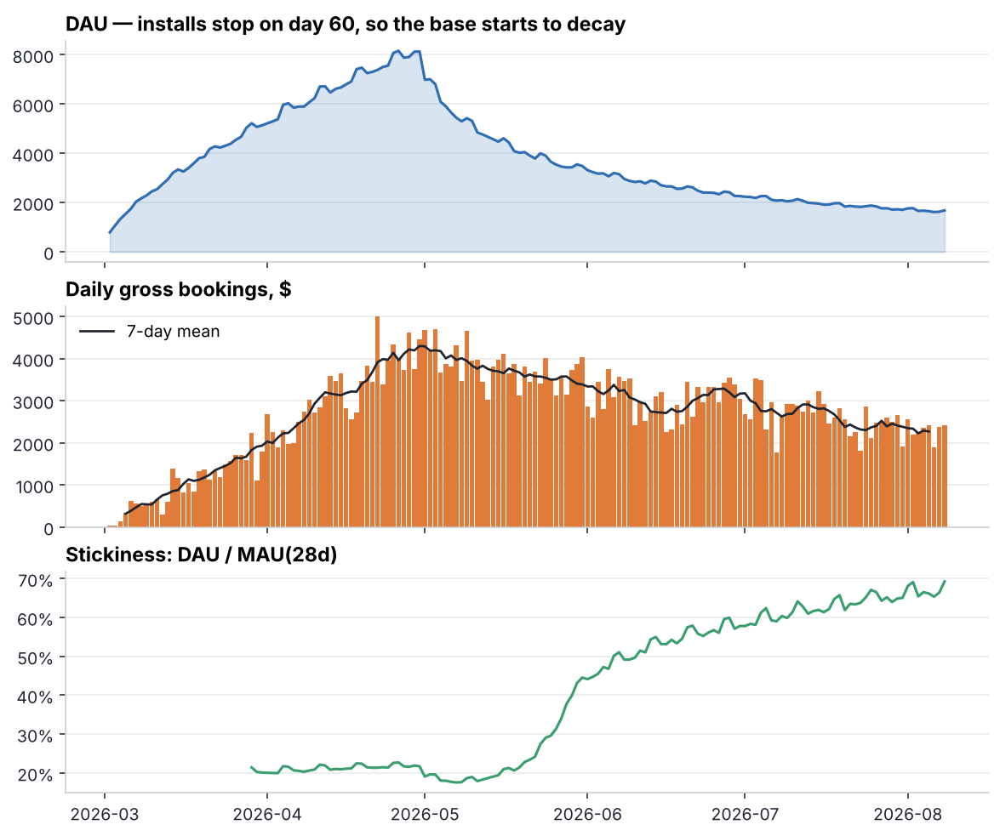
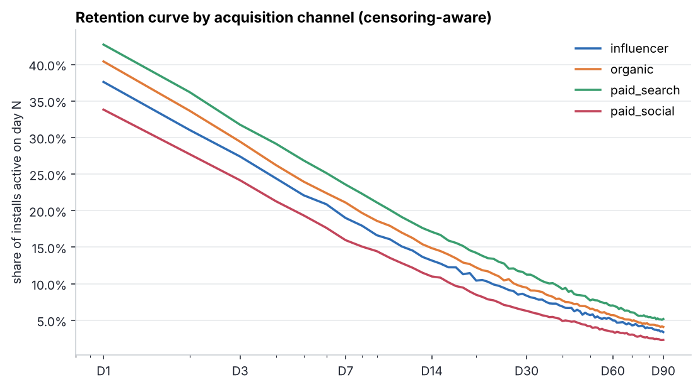
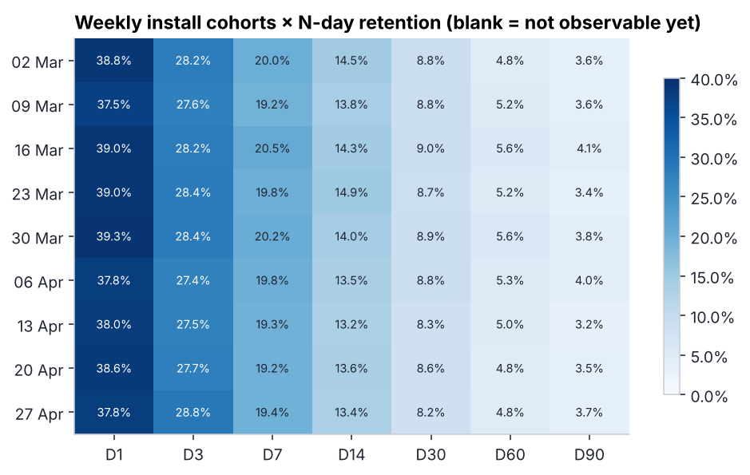
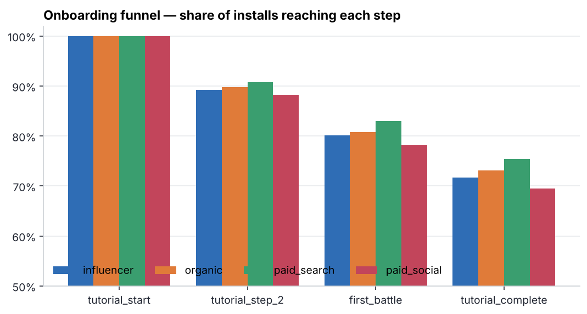
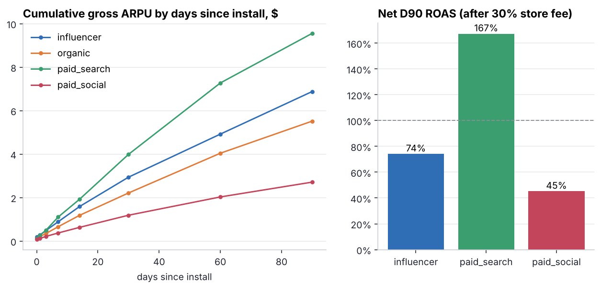
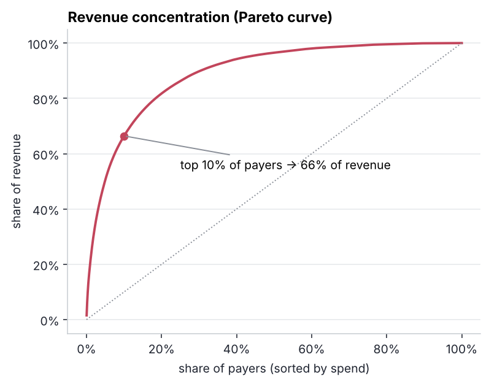

# 01 · Game telemetry & SQL metrics layer

> **Business question:** *How healthy is the game, and where does the money come from?*
> A reproducible metrics layer (DuckDB SQL) over raw F2P telemetry, with a data-quality
> suite that is proven to catch real-world logging defects.

## TL;DR

| Metric | Value |
|---|---|
| Players simulated | 60,000 installs over 60 days, observed for 160 days |
| Retention D1 / D7 / D30 / D90 | **38.4% / 19.7% / 8.7% / 3.7%** |
| Tutorial completion | 72.3% |
| Lifetime payer conversion | 5.8% |
| Gross ARPU D90 | $5.66 |
| Revenue concentration | top 10% of payers → **66%** of revenue; whales ($100+) = 24% of payers, 86% of revenue |
| Net D90 ROAS | paid_search **167%** · influencer **74%** · paid_social **45%** |

**Recommendation for UA:** paid_search pays back inside 90 days; paid_social loses ~55 cents per
dollar by D90 and should be cut or re-bid (see [project 04](../04-early-ltv-roas) for the
max-CPI calculation); influencer is borderline — its users monetise well but CPI is high.

## What is in here

```
sql/
  daily_kpis.sql                 DAU, installs, revenue, conversion, ARPDAU, ARPPU, sessions/DAU
  stickiness.sql                 DAU / rolling-28d MAU
  retention_cohorts.sql          weekly cohort × N-day retention (right-censoring handled)
  retention_curve_by_channel.sql D0–D90 curve with age-eligible denominators
  tutorial_funnel.sql            step conversion and step-to-step drop-off by channel
  ltv_roas_by_channel.sql        cumulative ARPU curves and ROAS vs CPI
  payer_concentration.sql        minnow / dolphin / whale tiers
  pareto_curve.sql               cumulative revenue share
  dq_checks.sql                  10 data-quality assertions (0 = pass)
run.py                           generates data → runs DQ suite → runs metrics → renders figures
reports/                         figures, CSV tables, results.json
```

Data comes from the shared simulator in [`gamesim/`](../gamesim/simulator.py): players have latent
engagement and spending traits, a 4-step tutorial, decaying churn hazard, sessions, level
progression and purchases across six price points.

## Data quality first

Before computing a single KPI, the pipeline runs `dq_checks.sql`. To show the suite actually works,
`run.py` also builds a copy of the data with **five typical production defects injected** — client
retries, device clock skew, test-device events, a broken promo, lost events:

| Check | Clean data | Defect-injected data |
|---|---:|---:|
| duplicate transaction ids | 0 | **82** |
| purchases before install (clock skew) | 0 | **200** |
| orphan events (no install record) | 0 | **150** |
| purchases on days without a session | 0 | **200** |
| non-positive / unknown price points | 0 | **50** |
| installs missing `tutorial_start` | 0 | **180** |
| funnel monotonicity violations | 0 | **165** |
| activity before install · implausible session counts · bulk duplicate rows | 0 | 0 |

Every injected defect is caught, and nothing fires on clean data. Note how one defect trips
several checks: skewed purchases show up both as "before install" and "without a session" — a
useful hint during root-cause analysis.

## Findings

### Topline


Installs run for 60 days and then stop, which makes the anatomy of the player base visible: DAU
falls quickly, while **revenue falls much more slowly**, because the players who stay are the
engaged, high-propensity ones. Stickiness (DAU/MAU) jumps from ~20% to ~65% for the same reason —
a reminder that **DAU/MAU is a mix metric**: it rises when you *stop* acquiring casual users,
not only when the game gets better.

### Retention



* Paid search brings the most engaged players; paid social the least (D30 gap ≈ 2×).
* Weekly cohorts are stable (D7 19–20.5%), so there is no product regression during the period.
* **Censoring:** late cohorts have empty D60/D90 cells instead of artificially low values. A naive
  `COUNT(active on day N) / cohort size` would show a fake retention drop for recent cohorts — a
  classic dashboard bug.

### Onboarding


Each tutorial step loses ~10% of players, so **28% of installs never finish it**, and in the
model they almost all churn on day 0. Losses are spread evenly across steps — no single
broken step. That points to *shortening* the tutorial rather than fixing one screen —
a good A/B candidate.

### Monetisation



ARPU curves are still rising at D90, so D90 ROAS *understates* lifetime ROAS: the influencer channel
may still pay back later. Project 04 forecasts this properly. Revenue is heavily concentrated, which
argues for whale-aware analysis everywhere: winsorised or CUPED metrics in A/B tests (project 02)
and targeting that avoids cannibalising whales with discounts (project 03).

## Run it

```bash
pip install -r requirements.txt
python 01-game-telemetry-sql/run.py      # ~10 s, writes data/ (git-ignored) and reports/
```

**Skills shown:** SQL (CTEs, window functions, cohort logic, censoring), DuckDB, data-quality
engineering, product metrics (retention, funnel, ARPDAU/ARPPU, ROAS, stickiness), communicating
caveats.
