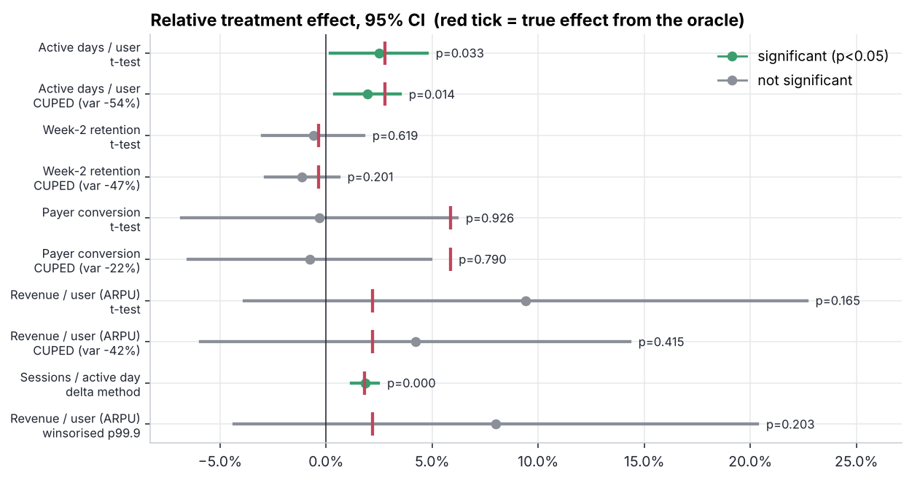
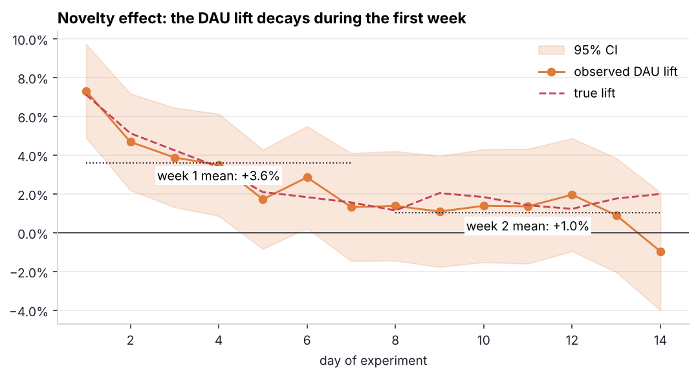
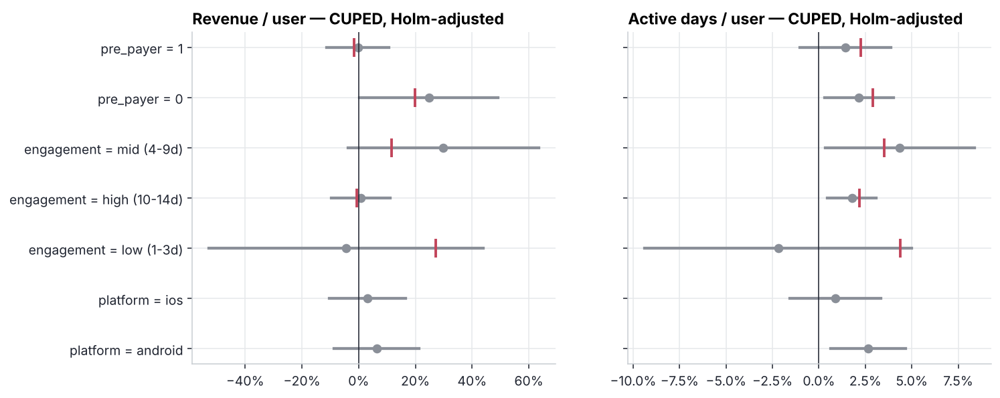
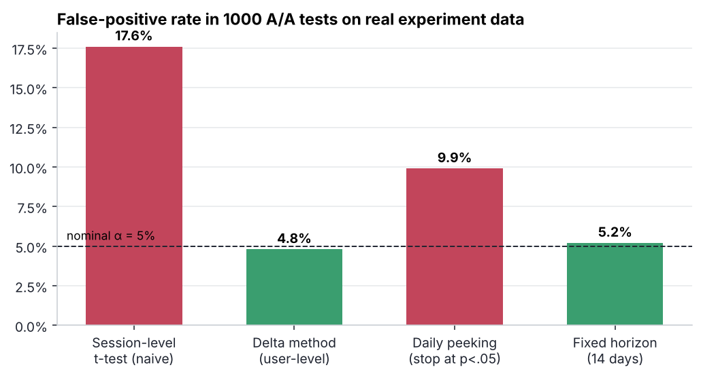

# 02 · A/B test deep dive — "Daily Rewards 2.0"

> **Business question:** *Should we ship the redesigned daily-login rewards to all players?*
> A full experiment readout, from power analysis to the ship decision. Because the experiment
> runs on a simulator, the **true effect is known** and every method is checked against it.

## TL;DR — decision

**Ship, but keep a long-term holdout, and treat revenue as unproven.**

* Engagement goes up for real: **+2.0% active days per player** (CUPED, 95% CI +0.4…+3.5%,
  p = 0.014; true effect +2.8%). Sessions per active day are **+1.8%** (delta method, p < 0.001).
* Most of the lift is **novelty**: +3.6% DAU in week 1, only +1.0% in week 2. Week-2 retention does
  not move. The long-run effect should be projected from week 2, not from the 14-day average.
* Revenue is **inconclusive**: ARPU +4.2% with a CI of −5.9…+14.3%. The test could only detect a
  ≥14% ARPU change (MDE), and the true effect is +2.2%. Proving that would take ~1M players per arm.
  A "+9% revenue!" headline from the plain t-test would be noise.
* The segment view (not significant after Holm correction) shows **non-payers** reacting
  (+25% revenue, true +20%) while **payers do not** (true −1.6%: free gems cannibalise purchases).
  That shapes the next iteration: keep the first-purchase reward and trim free gems for payers.

## Setup

| | |
|---|---|
| Population | players active in the 14 days before the test (51,316), installs via [`gamesim`](../gamesim/simulator.py) |
| Split | 50/50 salted hash of `player_id` (deterministic, stable across devices) |
| Duration | 14 days, fixed horizon, analysed intent-to-treat |
| Primary metric | active days per player |
| Secondary | sessions per active day (ratio), payer conversion, ARPU, week-2 retention |
| Guardrail | ARPU must not drop significantly |

**Truth injected into the simulator** (hidden from the analysis code): +0.10 logit on daily activity
plus a novelty bump of +0.25 decaying with a 2.5-day time constant, +3% sessions, +0.15 logit on
purchase propensity for non-payers and −0.05 for payers. The "true effect" in the charts comes from
an **oracle**: the same population simulated fully treated and fully untreated (4 seed pairs).

## 1 · Pre-registration: power & MDE

| Metric | Baseline (14 d) | MDE, t-test | CUPED variance reduction | MDE, CUPED |
|---|---:|---:|---:|---:|
| Active days / player | 4.01 | 3.2% | **54%** | **2.2%** |
| Week-2 retention | 34.3% | 3.4% | 47% | 2.5% |
| Payer conversion | 6.6% | 9.3% | – | – |
| ARPU | $3.23 | 18.2% | 41% | 13.9% |

CUPED uses each player's own pre-period value of the metric as the covariate. Cutting variance by
54% is worth **2.2× the sample size**, and it is the reason the primary metric reaches significance.
The table also shows the planning conclusion upfront: **this test cannot measure revenue**, so revenue
works as a guardrail, not as a success metric.

## 2 · Sanity checks

* **SRM:** 25,815 control vs 25,501 treatment, χ² p = 0.17 → no sample-ratio mismatch.
* **What an SRM looks like** (simulated logging bug: the new Android client drops the exposure event
  for half the low-activity treatment users) → p = 0.001. On the "exposed users" table the lift
  becomes **+5.2%, double the true effect**, because the players who vanished are exactly the least
  active ones. This is why the analysis is intent-to-treat on the *assignment* log.

## 3 · Results


Nine of ten intervals cover the true effect (red tick). That is what 95% intervals should do: one
miss in ten is in line with chance. The miss is payer conversion: the true +5.9% sits just outside
the CUPED interval, and the observed effect is ≈0. With a 9% MDE this metric is badly
underpowered, which is one more reason not to read anything into it. CUPED narrows the intervals. Winsorising ARPU at p99.9 helps less than expected: the noise comes from the
whole long tail of payers, not from one whale.

### Novelty


### Segments


Seven segments × two metrics = 14 tests. Five raw p-values fall below 0.05 (non-payer revenue
p = 0.048, plus several active-day segments), and after Holm correction none survive (lowest
adjusted p = 0.064). The segment chart is a **hypothesis generator
for the next test**, not a claim, even though the point estimates line up with the truth.

## 4 · Why the methodology matters: 1,000 A/A tests on this data


* **Ratio metrics:** a t-test on session-level rows treats sessions of the same player as
  independent and gives **17.6% false positives** instead of 5%. The delta method on user-level
  sums restores 4.8%.
* **Peeking:** checking daily and stopping at the first p < 0.05 doubles the false-positive rate (9.9%).
  The fix is either a fixed horizon (5.2%) or a sequential design (mSPRT / alpha-spending).

## 5 · Business impact

The CUPED ARPU point estimate (+$0.14 per player per 14 days) would mean ≈ **+$15k/month** across the
eligible base, but the CI runs from **−$21k to +$51k**. The case for shipping is engagement, with
revenue protected by a **5% holdout kept for 8 weeks**. That holdout grows the revenue sample and
shows where the novelty effect settles.

## Code

```
abstats.py   delta method, CUPED, SRM, bootstrap, MDE / sample size, Holm (unit-tested in tests/)
run.py       simulate → oracle truth → power → SRM → metrics → novelty → segments → A/A → decision
reports/     figures, results.json, CSV tables
```

```bash
python 02-ab-test-deep-dive/run.py   # ~30 s
```

**Skills shown:** experiment design, power analysis, CUPED, delta method for ratio metrics, SRM
diagnostics, novelty effects, multiple-testing correction, A/A validation of a methodology, and
turning uncertain results into a decision.
