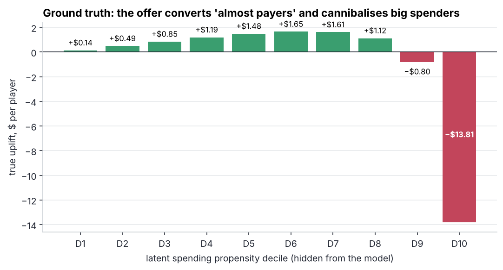
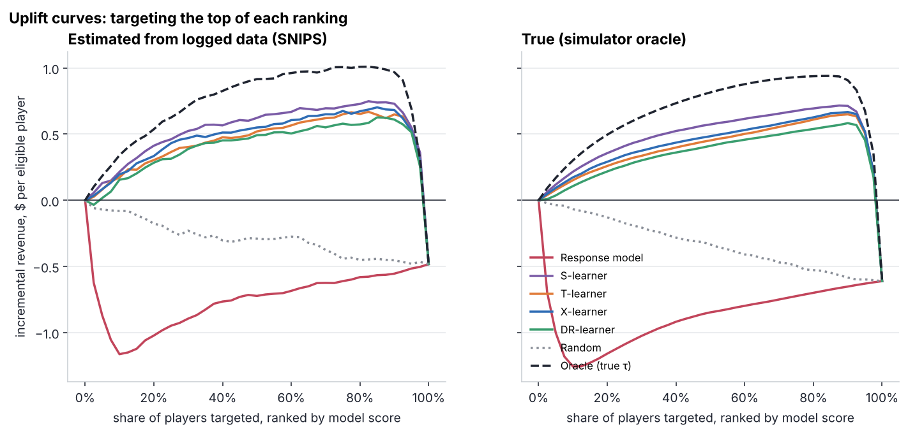
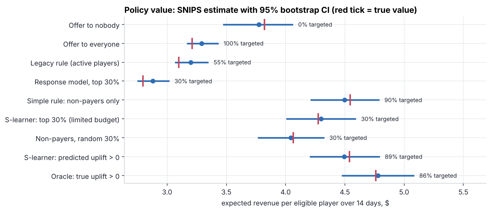
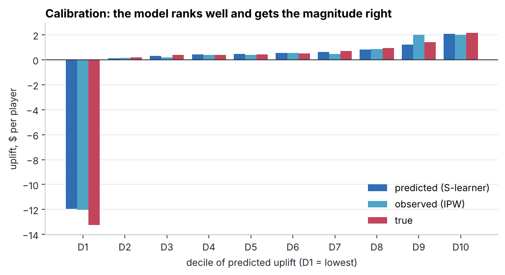

# 03 · Uplift modelling for personalised offers

> **Business question:** *Who should get the "50% off Gem Chest" offer?*
> Not "who is likely to buy", but **whose revenue goes up *because* of the offer**.

## TL;DR

* The A/B dashboard says the offer works: offered players spent **+$2.27** more. That is selection
  bias, because the legacy rule showed the offer mostly to active players. The IPW estimate is
  **−$0.62 per player**, and the true effect from the simulator is **−$0.61**. **Offering it to everyone loses money.**
* The reason: the offer converts price-sensitive "almost payers" but **cannibalises big spenders**,
  who swap a $20–100 purchase for the $9.99 chest.
* An S-learner (LightGBM) targeting policy turns the campaign from −$0.72 to **+$0.72 per eligible
  player**: ≈ **+$90k net revenue per 100k players per campaign** vs the legacy rule (true value: +$101k).
* Honest caveat: without a budget limit the model barely beats the simple rule "non-payers only"
  ($4.49 vs $4.50). **The model earns its keep under a budget**: with offers for only 30% of players,
  model ranking gets **+$0.45** vs **+$0.24** for random non-payers, almost **2×**.
* The classic mistake, a **response model** that targets the likeliest buyers, is the *worst* policy
  in the study (−$1.03 per player vs no offer). It picks exactly the whales who cannibalise.

## Data & ground truth

[`data.py`](data.py) simulates 120 days of telemetry with [`gamesim`](../gamesim/simulator.py) and
takes a snapshot of the **88,956** players active in the last 14 days. The 15 model features
come only from observable telemetry: recency/frequency, sessions, level, purchase history,
channel, platform, country tier.

* **Treatment assignment** follows the legacy rule "show to active players": propensity e(x) ∈ [0.2, 0.8],
  logged per player. That makes this an observational-style dataset where naive comparisons are biased.
* **Outcome:** gross revenue over the next 14 days.
* **Truth:** a structural outcome model on latent spending/engagement traits gives each player's true
  uplift τ. The model never sees it; it is used only for evaluation.



## Methods

| Learner | Idea |
|---|---|
| Response model | P(buy \| offered), the baseline marketing usually starts with |
| S-learner | one LightGBM with treatment as a feature, τ̂ = f(x,1) − f(x,0) |
| T-learner | separate models for treated and control |
| X-learner | imputes individual effects, blends with the logged propensity |
| DR-learner | doubly-robust pseudo-outcome, 2-fold cross-fitting |

**Off-policy evaluation without the truth.** A policy π(x) ∈ {offer, no offer} is evaluated on the
held-out 40% via inverse propensity scoring: `V̂(π) = Σ wᵢ yᵢ / Σ wᵢ` with
`wᵢ = 1[tᵢ = π(xᵢ)] / P(tᵢ | xᵢ)` (SNIPS; plain IPS is reported too). CIs come from a bootstrap. Because
the simulator knows τ, the project also **validates the evaluation method itself**: every SNIPS
interval below contains the true policy value.

## Results



The SNIPS-estimated curves (left) track the true curves (right), so in production, where τ is
unknown, this evaluation can be trusted. All uplift learners peak around 85–90% targeted, while the
response model falls straight below zero: its top-ranked players are the cannibalised whales.

| Model | Spearman(τ̂, τ) | PEHE (RMSE, $) | Targeted (τ̂ > 0) | Incremental $/player — SNIPS | — true |
|---|---:|---:|---:|---:|---:|
| **S-learner** | **0.54** | 4.63 | 89% | **+0.72** | **+0.72** |
| X-learner | 0.41 | 4.54 | 80% | +0.68 | +0.63 |
| T-learner | 0.36 | 4.74 | 76% | +0.65 | +0.58 |
| DR-learner | 0.36 | 4.93 | 83% | +0.60 | +0.55 |
| Response model | 0.18 | – | – | – | – |
| Oracle (true τ) | 1 | 0 | 86% | +1.00 | +0.94 |

The S-learner wins here because the effect is driven mostly by one strong feature (payer history),
which S-learners capture well. With weaker, more diffuse heterogeneity, X/DR learners usually come out
ahead, so the choice of learner is an empirical question that has to be settled by off-policy
evaluation, as done here.



| Policy | Targeted | SNIPS value, $/player (95% CI) | True value | True Δ vs no offer |
|---|---:|---:|---:|---:|
| Offer to nobody | 0% | 3.78 (3.48–4.06) | 3.82 | – |
| Offer to everyone | 100% | 3.29 (3.17–3.43) | 3.21 | −0.61 |
| Legacy rule (active players) | 55% | 3.20 (3.07–3.34) | 3.10 | −0.72 |
| Response model, top 30% | 30% | 2.88 (2.76–3.01) | 2.80 | **−1.03** |
| Simple rule: non-payers only | 90% | 4.50 (4.22–4.78) | 4.54 | +0.72 |
| Non-payers, random 30% | 30% | 4.05 (3.77–4.32) | 4.06 | +0.24 |
| **S-learner, top 30% (budget)** | 30% | **4.30** (4.01–4.59) | 4.27 | **+0.45** |
| **S-learner, τ̂ > 0** | 89% | **4.49** (4.21–4.79) | 4.54 | **+0.72** |
| Oracle, τ > 0 | 86% | 4.78 (4.48–5.08) | 4.76 | +0.94 |



The lowest decile of predicted uplift is where the money is lost (−$12 per player), and the model,
the IPW estimate and the truth all agree on it.

## Recommendation

1. **Stop the blanket offer** and the legacy rule now; both destroy value.
2. **Roll out the S-learner policy** with a **10% randomised holdout** (uniform propensity), to keep
   measuring uplift and to retrain on clean data.
3. If offer inventory is limited, rank by τ̂: it is worth ~2× a random allocation.
4. Next test: a **different offer for payers** (e.g. bonus gems on top of a regular pack instead of a
   cheaper chest), because that segment needs value added, not a discount.

## Run it

```bash
python 03-uplift-offer-targeting/run.py   # ~30 s
```

**Skills shown:** causal inference (selection bias, IPW), meta-learners (S/T/X/DR) with LightGBM,
off-policy evaluation (IPS/SNIPS + bootstrap), uplift/Qini curves, calibration, budget-constrained
targeting, translating uplift into money.
