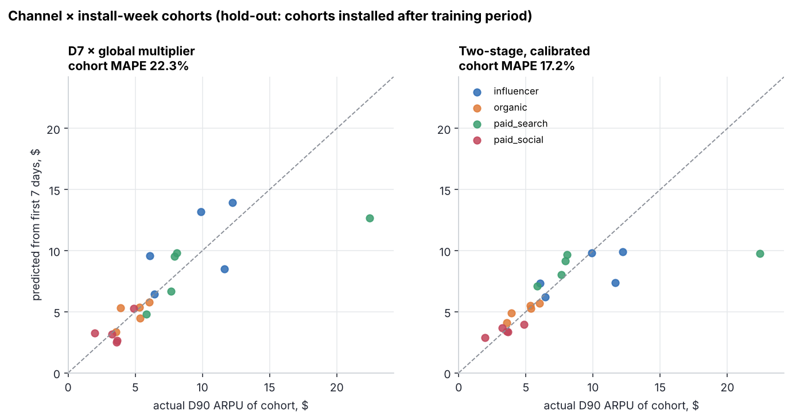
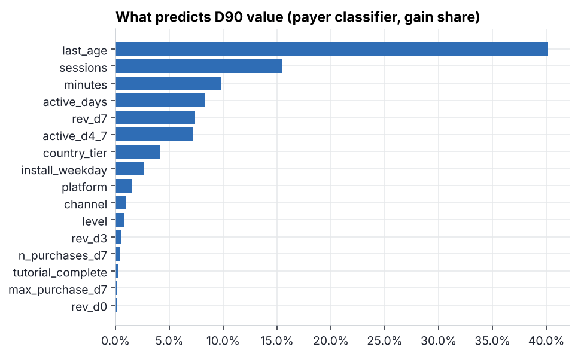
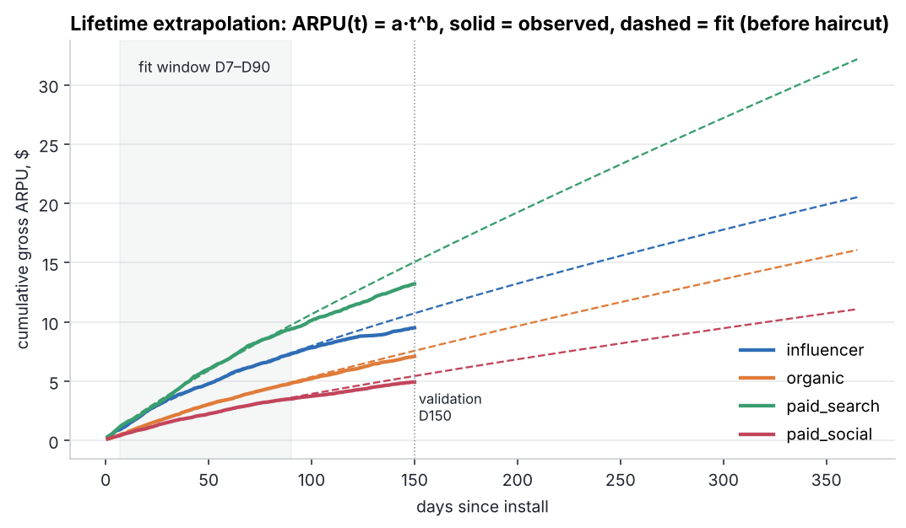
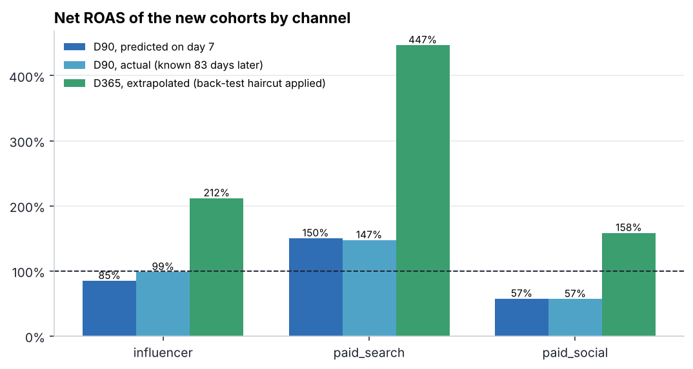

# 04 · Early LTV prediction → ROAS → bids

> **Business question:** *Which acquisition channels should we scale or cut, and what CPI can we
> afford, without waiting 90 days for cohorts to mature?*

## TL;DR

| Channel | CPI | Net D90 ROAS, predicted on **day 7** | Actual D90 ROAS (83 days later) | Payback day | Max CPI (D180 payback) | Bid action |
|---|---:|---:|---:|---:|---:|---|
| paid_search | $4.00 | **150%** | 147% | 56 | $9.78 | **scale up**, room to bid +145% |
| influencer | $6.50 | 85% | 99% | 131 | $8.23 | raise to ~$8 |
| paid_social | $4.20 | **57%** | 57% | 206 | $3.79 | **cut bid ~10%**, or fix creatives / targeting |

* A **two-stage model** (P(pays later) × expected spend, LightGBM) reads the first 7 days
  and predicts cohort D90 value with **−1% total bias** and **17% MAPE on channel-week cohorts**. That
  is already at the **sampling-noise floor (≈18%)**, so no model can do much better on cohorts of
  ~500 installs.
* The simple **"D7 revenue × multiplier"** benchmark is just as good at the **channel** level (3.7% vs 5.7%
  MAPE) but far worse at ranking players (AUC 0.71 vs 0.96). Use the multiplier for weekly channel
  reports, and the model for **user-level value signals** (value-based bidding, early VIP care) and
  small cohorts.
* Lifetime curves are extrapolated with a power law, **back-tested on D150**: the raw fit over-predicts
  by ~10%, so a haircut is applied, and bids follow the D180 payback rule rather than an optimistic D365.

## Data

[`gamesim`](../gamesim/simulator.py) generates 120k installs over 90 days, each observed for at least 90 days.
**Time-based split:** cohorts installed on days 0–59 train the models (73.6k installs), and cohorts from days
60–89 are the "new" cohorts the UA manager has to decide on (46.4k installs). Features use only the first
7 days: revenue on D0/D3/D7, purchases, max price point, active days (total and D4–7), sessions,
minutes, level, recency, tutorial completion, channel, platform, country tier.

## Models

| Model | Total bias | Cohort MAPE | Channel MAPE | AUC (top spenders) |
|---|---:|---:|---:|---:|
| Channel average (no early signal) | −0.4% | 24.5% | 5.7% | 0.59 |
| D7 revenue × global multiplier | +1.1% | 22.3% | **3.7%** | 0.71 |
| D7 revenue × channel multiplier | +1.2% | 22.2% | 5.6% | 0.71 |
| LightGBM Tweedie (raw) | **−18.0%** | 18.3% | 18.6% | 0.96 |
| LightGBM Tweedie, calibrated | +3.9% | 19.6% | 7.7% | 0.96 |
| **Two-stage, calibrated** | **−1.0%** | **17.2%** | 5.7% | **0.96** |

**Lesson worth highlighting:** tree models on a heavy-tailed target (whales) systematically
**under-predict the mean**. The raw Tweedie model is 18% too low in total, and a UA team acting on it
would cut good channels. The fix is an out-of-fold calibration factor estimated on the training cohorts
(×1.19 for the two-stage model). Total bias matters more than RMSE for budget decisions.



The visible outlier (a paid_search week at $22 actual) is one cohort with a few whales: unpredictable
by construction, and the reason cohort-level forecasts should come with intervals.



Recency (last active day within the first week) and engagement depth dominate. Early revenue matters
less than expected: 63% of D90 payers have not paid by day 7, and 88% of D90 revenue arrives after it.

## From D90 to lifetime



`ARPU(t) = a·t^b` is fitted per channel on D7–D90 of the oldest cohorts and validated against their actual D150:

| Channel | b | D150 actual | D150 fit | Error |
|---|---:|---:|---:|---:|
| organic | 0.85 | $7.11 | $7.58 | +6.6% |
| paid_social | 0.80 | $4.94 | $5.45 | +10.3% |
| influencer | 0.73 | $9.52 | $10.74 | +12.8% |
| paid_search | 0.85 | $13.21 | $15.06 | +14.0% |

The power law is systematically optimistic (real curves decelerate as payers churn), so all
extrapolations beyond D90 get the average back-test haircut (×0.90). Even so, D365 numbers should be
read as an upper bound, which is why the bid rule is **D180 payback**.



## Decision logic

```
max_CPI(channel) = 0.70 × LTV_D180(channel)
LTV_D180 = predicted D90 ARPU (model, day 7) × curve_shape(180/90) × back-test haircut
```

The day-7 prediction gets paid_search and paid_social right within 3 pp of ROAS. It under-reads influencer
(85% vs 99%), whose value depends on rare whales, so for that channel the recommendation is to raise bids
step by step and re-check at D30.

## Run it

```bash
python 04-early-ltv-roas/run.py   # ~20 s
```

**Skills shown:** LTV modelling (Tweedie, hurdle/two-stage), time-based validation, calibration of
heavy-tailed predictions, cohort-level error analysis and noise floors, LTV curve extrapolation with
back-testing, ROAS / payback / max-CPI economics for UA.
