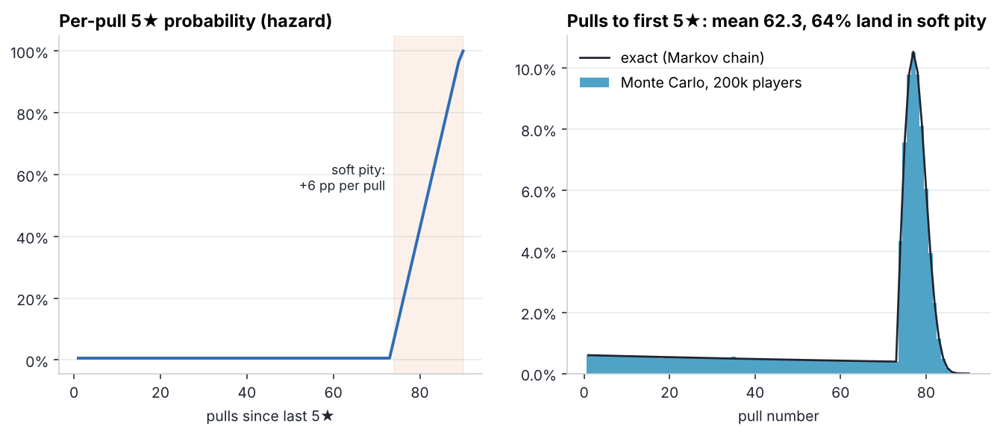
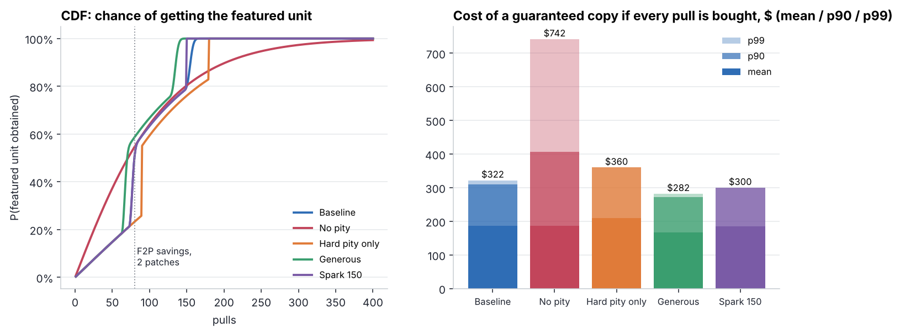
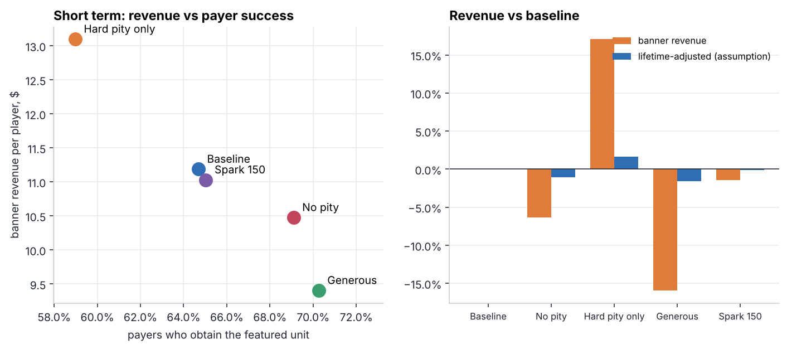
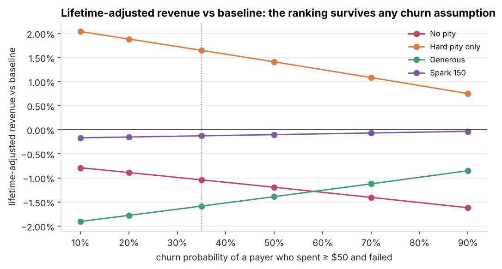

# 05 · Gacha banner economy: pity, fairness and revenue

> **Design question:** *How should a limited-character banner be tuned: base rate, soft/hard
> pity, 50/50 and spark? What does each lever do to revenue and to the player's experience of luck?*

## TL;DR

* The baseline design (0.6% base rate, soft pity from pull 74, hard pity at 90, 50/50 with a guarantee,
  the structure popularised by Genshin Impact) has a **consolidated 5★ rate of 1.6%** (1 in 62.3 pulls),
  even though the advertised base rate is 0.6%. **64% of all 5★ drops happen inside soft pity.**
* Getting the featured unit takes **93 pulls on average**, 155 at p90 and at most 180. At $2 per pull a
  guaranteed copy costs **$187 on average, $322 at p99**.
* **A flat rate with the same mean** looks "fairer", but it has an unbounded tail: p99 = 371 pulls ($742).
  Its **revenue is also 6% lower**, because pity pushes players to buy the last few pulls to reach a
  near-certain drop.
* **Removing soft pity** (hard 90 only) raises revenue by **+17%**, but payer success drops 65% → 59% and
  "regret" (spent ≥ $50 and failed) goes 15.8% → 19.5%.
* **Recommendation:** keep the baseline and **add a 150-pull spark**. It costs **−1.4%** banner revenue,
  removes the worst-case outcomes (no player ever needs more than 150 pulls), and gives marketing a clear
  promise to communicate.

## Engine

[`gacha.py`](gacha.py) contains two independent implementations that check each other:

* **Exact distributions** via a forward Markov chain over states *(pulls since last 5★, guarantee flag)*.
  This handles soft/hard pity, the 50/50 with guarantee, and sparks. It returns the full PMF of pulls to
  the featured unit.
* **Vectorised Monte Carlo** (200k players per design).

The two agree to within MC noise (e.g. a mean of 93.45 exact vs 93.57 MC for the baseline), and
[`tests/`](../tests) asserts it.



## Five designs

| Design | Mean pulls | Median | p90 | p99 | Worst case | Mean cost | p99 cost |
|---|---:|---:|---:|---:|---:|---:|---:|
| **Baseline** (soft 74, hard 90, 50/50 + guarantee) | 93.4 | 80 | 155 | 161 | 180 | $187 | $322 |
| No pity, flat 1.6% (same mean) | 93.4 | 72 | 203 | 371 | ∞ | $187 | $742 |
| Hard pity 90 only | 104.5 | 90 | 180 | 180 | 180 | $209 | $360 |
| Generous (soft 64, hard 80) | 83.7 | 71 | 136 | 141 | 160 | $167 | $282 |
| **Baseline + spark at 150** | 92.3 | 80 | 150 | 150 | **150** | $185 | $300 |



**A less obvious effect:** the flat-rate design gives the *best* odds to a player with few pulls
(31% within 40 pulls vs 12% for the baseline). Pity **back-loads** probability: a player who saved
fewer than ~74 pulls is unlikely to succeed. That is what makes pity systems drive **saving behaviour**
(log in, do dailies, hoard currency for the banner you want) and **conversion** ("only 12 pulls to
soft pity, $24 away"). Pity is an engagement mechanic as much as a fairness one.

## Revenue vs experience

A population of 300k players (75% F2P, 20% dolphins with a median budget of $60, 5% whales with a median of $600;
free saved pulls log-normal with a median of 60) plays one banner and pulls until they get the featured unit or
run out of currency. Pulls needed are drawn by inverse CDF with the **same random number per player
across designs** (common random numbers), so differences between designs are not sampling noise.

| Design | Revenue / player | vs baseline | Success: all | F2P | Payers | Payer regret* |
|---|---:|---:|---:|---:|---:|---:|
| Baseline | $11.19 | – | 39.2% | 30.7% | 64.7% | 15.8% |
| No pity | $10.48 | −6.4% | 51.4% | 45.5% | 69.1% | 15.5% |
| Hard pity only | **$13.10** | **+17.1%** | 34.7% | 26.6% | 59.0% | **19.5%** |
| Generous | $9.40 | −15.9% | 44.2% | 35.6% | 70.3% | 12.5% |
| Spark 150 | $11.03 | −1.4% | 39.3% | 30.8% | 65.0% | 15.5% |

\* spent ≥ $50 on the banner and still did not get the unit.



### Does bad luck cost more later?

A long-term view adds an explicit, adjustable assumption: payers who regret churn with probability *c*
(base churn 8%), and a retained payer is worth three more banners. Even at *c* = 90%, the harsher design
still wins on modelled money (+0.8%), because regret moves only a few percentage points between designs.



**So the case for player-friendly tuning cannot rest on a short-horizon revenue model.** It rests
on things this model does not price: community sentiment and review scores, regulatory exposure
(several markets require odds disclosure, and some restrict paid random items), and brand trust over
years. A spark is the cheap way to buy that insurance (−1.4%).

## Responsible design checklist

* Publish the **consolidated** rate (1.6%), not just the 0.6% base rate, together with pity rules.
* Show the **pity counter** in the UI, so the guarantee is visible rather than hidden.
* Carry pity and the guarantee **over between banners** (assumed in this model), so missing out does not
  reset progress.
* Use a **spark** to bound the worst case.
* Track regret and spend velocity as **guardrail metrics** in every banner A/B test, and offer spending limits.

## Run it

```bash
python 05-gacha-economy/run.py   # ~5 s
```

**Skills shown:** probability modelling (Markov chains, hazard functions), Monte Carlo with variance
reduction, game-economy design trade-offs, scenario and sensitivity analysis, responsible-monetisation thinking.
