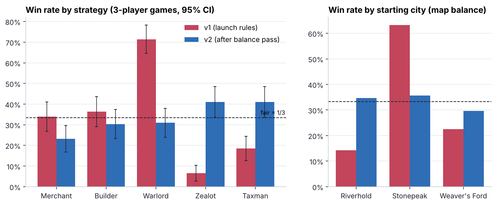
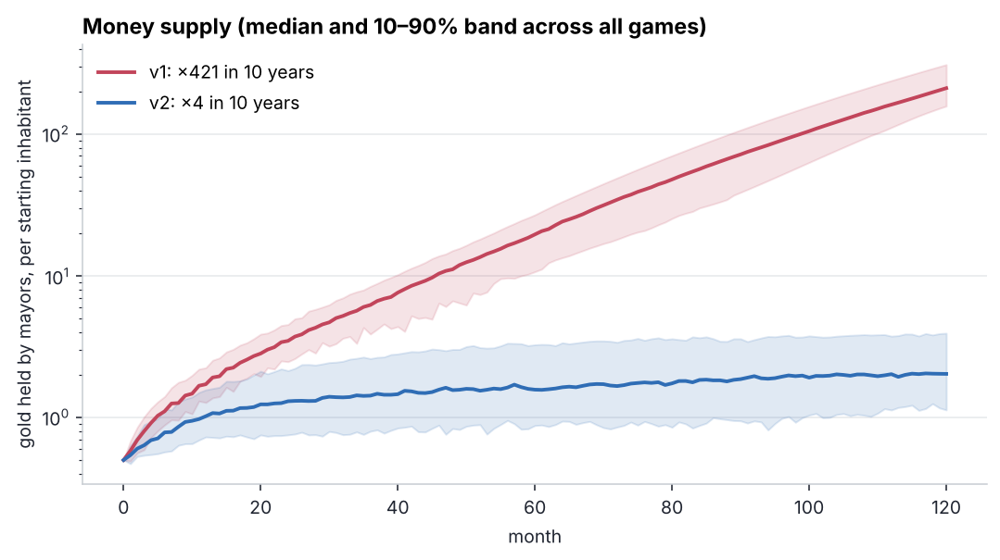
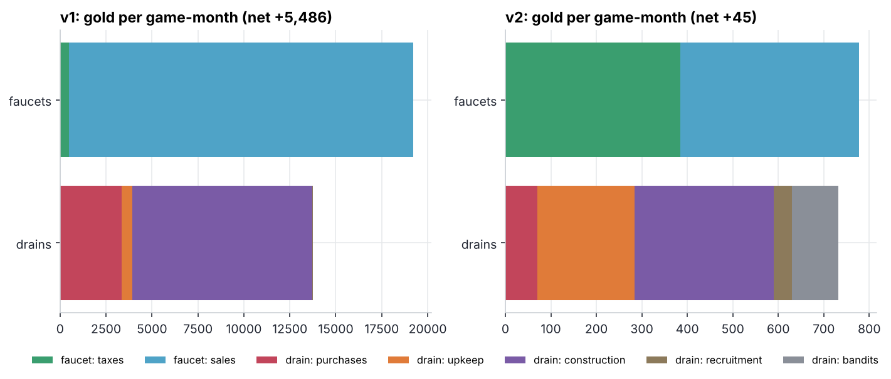
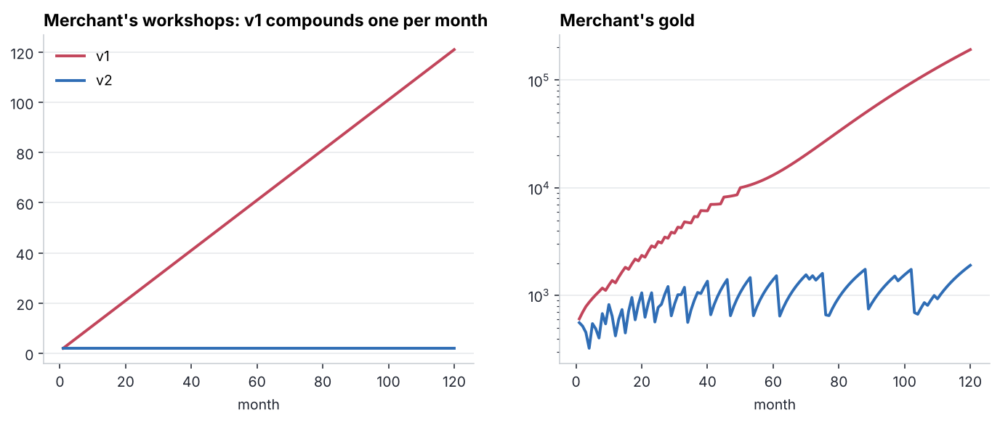
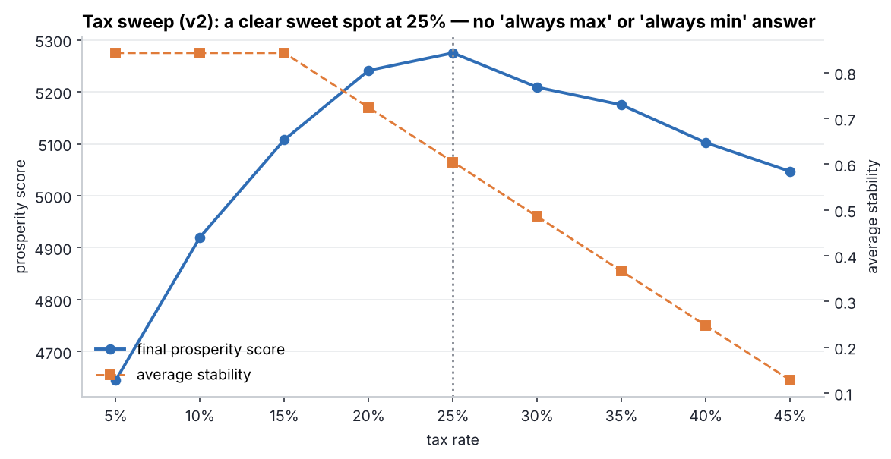
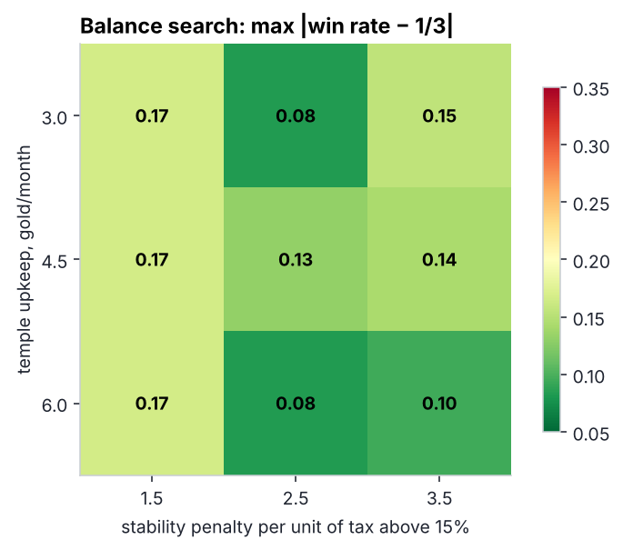

# 06 · Economy design & balance: a medieval city-management game

> **Design question:** *Does the economy of my game hold up, or is there an inflation spiral, an exploit
> or a dominant strategy?* Finding out with bots and simulation before players do.

This is the economy model of my pet-project game concept: the player is the **mayor of one of three
cities** (plus a neutral capital market) and manages food, cloth, trade, taxes, buildings, temples
(stability) and an army (defence and raids).

## TL;DR

| Problem found in v1 (launch rules) | Evidence | Fix in v2 | Result |
|---|---|---|---|
| **Runaway inflation**: gold supply ×421 in 10 years | capital market = infinite liquidity; sales are 97% of all gold inflow | price impact + 8% transport fee, bandits as a sink | money ×4 (while population grows ×2–3) |
| **Infinite-money exploit**: buy iron + timber, craft weapons, sell them back to the capital | +2.4 gold margin per weapon; the Merchant bot builds a workshop **every month** (121 by year 10) | weapon price 10 → 8; the margin turns negative unless you own caravans, and price impact caps it | the Merchant stops at 2 workshops |
| **Dominant strategy**: Warlord wins **71%** of games | loot scales with everyone's hoards; raids cost nothing | war weariness, army attrition per raid, loot share 25% → 20% | Warlord 31% |
| **Useless strategy**: Zealot wins 7% | temples buy stability that is capped and worthless in a gold-flooded economy | stability matters again once money is scarce; temple upkeep and the growth effect tuned | Zealot 41% |
| **Map imbalance**: Stonepeak wins 63% | it sells iron into an infinitely liquid market | iron output 6 → 5, grain deficit reduced | cities 30–36% |

After the balance pass, **every strategy wins 23–41%** of 3-player games (fair = 33%) and **every starting
city 30–36%**. The tax sweep shows a clear sweet spot (25%) instead of "always max" or "always min".
Merchant (23%) and Zealot/Taxman (41%) remain the next balancing targets.

## The model ([`economy.py`](economy.py))

* **3 cities**, each specialised (Riverhold: grain; Stonepeak: iron and timber; Weaver's Ford: cloth), plus
  a **neutral capital** that buys and sells every good.
* Monthly loop: production (population × productivity × buildings × stability) → consumption (grain, cloth,
  weapon wear) → crafting (iron + timber → weapons) → trade with the capital → taxes and upkeep →
  recruitment → construction → raids → bandits → population and stability.
* **Faucets** (gold enters): taxes, sales to the capital. **Drains** (gold leaves): purchases, upkeep,
  construction, recruitment, bandits. Raids only *move* gold.
* **5 bot strategies** (tax rate, army size, what to invest in): Merchant, Builder, Warlord, Zealot, Taxman.
* Every balance lever is a field of `Rules`, so v1 and v2 are two parameter sets of the same code.

**Tournament:** all 35 line-ups of 3 strategies (with repetition) × 8 seeds × random seating =
**280 games of 120 months per rules version**. The score is population + ½ net worth + 40 × buildings.

## Findings

### 1 · Win rates


### 2 · Inflation: an infinite-liquidity market is a gold printer



In v1 the capital buys any amount at a fixed price, so **sales generate ~40× more gold than taxes**,
and the drains cannot keep up (net +5,486 gold per game-month). Every price in the game loses its
meaning: a building costing 300 gold is trivial when you hold 250,000. In v2 sales and taxes contribute
equally, and faucets ≈ drains (net +45 per month), which is the healthy shape.

### 3 · The exploit


`weapon sell price (9.0) − iron (4.4) − timber (2.2) = +2.4 gold`, with no limit on volume. Each workshop
pays for itself within a few months, so the Merchant compounds workshops. In a live game this is the
Reddit post titled *"infinite gold, 10 minutes"*. v2 closes it at three layers: the base price (margin
−0.5 per weapon before impact), the transport fee, and price impact, so even the Merchant's discounted
caravans make only a small, self-limiting profit.

### 4 · The player's core decision is interesting


Below 15% tax there is no stability cost, so taxes are free money. Above it, stability falls, and with it
production, growth and future tax income. The optimum (≈ 25%) sits inside the range, so the decision is
an actual trade-off rather than a solved problem.

### 5 · Balance search


A 3×3 grid over two levers (4 seeds per cell, 140 games each). The robust signal is the **column at
penalty 2.5**: too soft and Taxman dominates, too hard and Zealot does. Differences along the temple-upkeep
axis (0.08 vs 0.13) are within the noise of a 4-seed tournament (SE ≈ 0.05 per win rate). The
8-seed evaluation of the chosen setting gives a max deviation of 0.10.

## What I would do next

1. Buff the Merchant (e.g. trade contracts between cities that bypass the capital).
2. Make the bots adaptive (each bot switches strategy when losing), then check that no strategy stays
   dominant once opponents respond: a Nash-style check of the strategy meta.
3. Port the v2 numbers into the playable prototype and compare real play sessions with the simulated ones.

## Run it

```bash
python 06-medieval-trade-sim/run.py   # ~1.5 min
```

**Skills shown:** game-economy design (faucets/drains, inflation, sinks, arbitrage), agent-based simulation,
bot tournaments for balance, parameter search, statistical noise in balance testing, design documentation.
