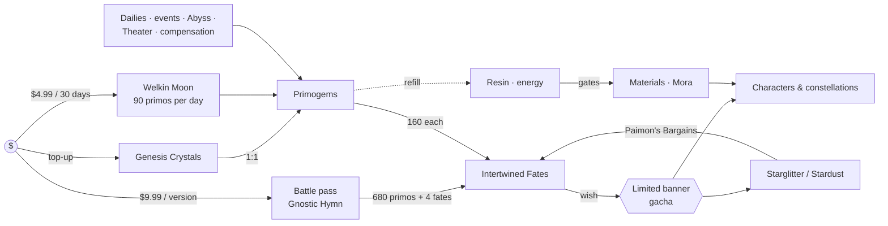
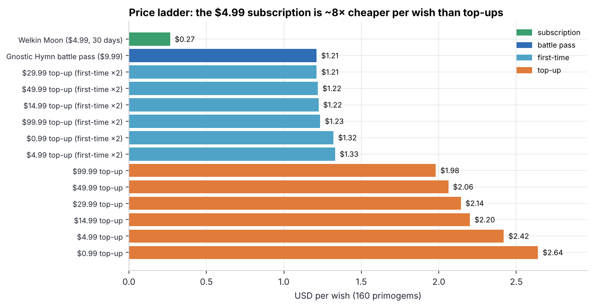
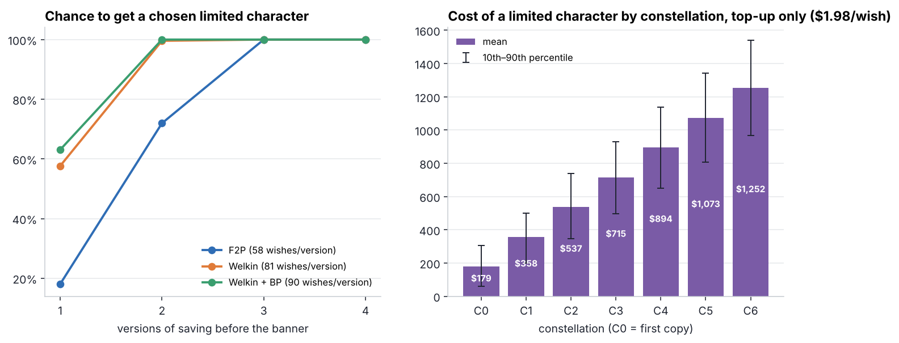

# 07 · Monetisation teardown: Genshin Impact, quantified

> **Question:** *How does one of the most successful F2P gacha games turn free players into payers
> and payers into high spenders, and what would I test next as its economist?*
> A design teardown backed by numbers: every price and rate below is public, and the probabilities come
> from the exact wish engine built in [project 05](../05-gacha-economy).

*Prices are US list prices; free-income figures are a community estimate for one ~6-week version
(v5.4) and vary from patch to patch. Sources are at the bottom. This is an outside-in analysis based on
public information.*

## TL;DR

* **The ladder is designed around one product:** the $4.99 Welkin Moon gives a wish for **$0.27**, while
  top-ups cost **$1.98–2.64** (7–10× more). It is the conversion product that turns F2P players into
  payers, and the daily login it requires is a retention mechanic in its own right.
* **Pacing is tuned so the cheapest payers get about one limited character per version:** F2P earns
  ~58 limited wishes per version, Welkin + battle pass ~90, and the average cost of a featured character is
  ~90 wishes. F2P players get there every ~1.6 versions and have to *choose*.
* **The real revenue lives in depth, not breadth.** Duplicates (constellations) scale linearly: C6 costs
  ~632 wishes, **≈ $1,250** at the best top-up rate. A whale collecting C6 of every second banner spends
  ≈ **$780/month**, about 64× a Welkin + BP player.
* **Gacha fairness has been tuned over time:** a 0.6% base rate becomes 1.6% consolidated through soft
  pity, there is a hard cap of 180 wishes, and since v5.0 "Capturing Radiance" raises the featured share of a
  50/50 to ~55%. Each change lowers the variance players feel without touching the headline rates.
* **What I would test next:** (1) a mid-price monthly tier between $12 and the $100 top-up cliff, (2) a
  visible pity/guarantee counter in the wish UI, (3) a 150-wish spark, estimated in project 05 at −1.4%
  banner revenue in exchange for a bounded worst case.

## 1 · Economy map



There are two sinks for premium currency (wishes, resin refills) and one partial rebate loop (Starglitter
and Stardust buy back more Fates). Resin is the classic **energy gate**: it paces progression, so
characters acquired faster than resin allows are a soft incentive to refill.

## 2 · Price ladder



| Offer | Price | Primogem-equivalent | Wishes | $/wish |
|---|---:|---:|---:|---:|
| Welkin Moon (30 days) | $4.99 | 3,000 | 18.8 | **$0.27** |
| Gnostic Hymn battle pass (+ materials) | $9.99 | 1,320 | 8.3 | $1.21 |
| First-time top-up (×2), any tier | $0.99–99.99 | 2× base | – | $1.21–1.33 |
| $99.99 top-up (6,480 + 1,600) | $99.99 | 8,080 | 50.5 | $1.98 |
| $0.99 top-up | $0.99 | 60 | 0.4 | $2.64 |

Observations:

* **Decoy-free anchoring.** Every step up the ladder is cheaper per wish, which rewards bigger baskets,
  and the Welkin makes every top-up look expensive by comparison. That is deliberate: it keeps most
  payers on a *recurring* product, and the top-up exists for the moment of high intent (a banner ends tomorrow).
* **First-time double bonuses** halve the price of the first purchase at each tier. Their periodic resets
  are, in effect, a **re-activation campaign** for lapsed payers built into the store.
* **The gap:** after Welkin + BP (~$12/month) the next step is open-ended top-ups. No product targets the
  $20–50/month "dolphin" who wants one guaranteed character per version (see proposal 1).

## 3 · Pacing: what each spending tier can afford



| Tier | Limited wishes / version | Cost / year | Featured characters / year (expected) |
|---|---:|---:|---:|
| F2P | 57.6 | $0 | 5.5 |
| Welkin | 81.3 | $61 | 7.8 |
| Welkin + BP | 89.5 | $148 | 8.6 |

The expected wishes per featured 5★ is **93.4** with a pure 50/50 and **90.3** with Capturing Radiance
(approximated as a 55/45 coin). The left chart shows the design intent: an F2P player who saves for one
version has an **18%** chance at a chosen character, and **72%** after two versions. The cheapest payer is
near 60% after one version and certain after two. **The game sells certainty and time, not access**: anyone
can get anything eventually.

## 4 · Where the money is: depth

A spender buying every wish at $1.98 pays on average $179 for C0, $537 for C2, and **$1,252 for C6**
(p90: $1,540). Because the wish count grows linearly with copies, and each copy is a visible power or
cosmetic upgrade, constellations are the high-ARPPU engine. Breadth (collecting every character) is
largely covered by free income plus the Welkin.

| Archetype | Spend / month |
|---|---:|
| Welkin only | $4.99 |
| Welkin + battle pass | $12.13 |
| + one guaranteed featured per version | ~$13.30 |
| Whale: C6 of every second banner | **~$780** |

## 5 · What I would test next

**1. A mid-price monthly tier (≈$14.99), e.g. Fates plus an exclusive cosmetic.**
*Hypothesis:* it converts Welkin-only players who currently top up irregularly into a stable recurring
tier, lifting ARPPU in the $5–50 segment without cannibalising whales (they are bound by constellations,
not by price per wish). *Design:* a geo-split test (store pricing cannot be randomised per user). Primary metric:
payer ARPPU; guardrails: whale spend and Welkin churn.

**2. A visible pity and guarantee counter in the wish screen.**
Players already track pity with third-party tools, so in-game transparency costs little and reduces the
"rigged" perception. Regulation of loot boxes and paid random items is heading toward more disclosure.
*Metrics:* refund requests, support tickets, review sentiment, spend stability.

**3. A 150-wish spark on character banners** (or a more generous Capturing Radiance).
The project 05 model estimates **−1.4% banner revenue** in exchange for a hard bound on the worst case. That
is cheap insurance against the most damaging player stories (*"I spent $350 and lost two 50/50s"*).

**4. Re-activation timing for first-time bonus resets.** Tie the resets to banners of characters with
high pre-registration interest, and measure incremental reactivated payers with a holdout region.

## Method notes

* The wish distribution is computed **exactly** with a Markov chain (soft pity from wish 74, +6 pp per wish,
  hard pity 90, 50/50 with guarantee) and agrees with the consolidated 1.6% rate published on the wiki.
* After a featured character is obtained the state resets (pity 0, no guarantee), so the wish count for *k*
  copies is the *k*-fold convolution of the single-copy distribution.
* Free income is one patch estimate (8,420 primogems + 5 Intertwined Fates). Real income varies with
  events and anniversaries.

## Sources

* [Genshin Impact Wiki — Wish](https://genshin-impact.fandom.com/wiki/Wish): rates, pity, 50/50, Capturing Radiance (consolidated ~55%), weapon banner
* [Startselect — Genesis Crystal packs](https://startselect.com/ie-en/game-points/genshin-impact-genesis-crystals): base + bonus crystals per tier
* [GameWith — Genesis Crystal prices](https://gamewith.net/genshin-impact/article/show/22406): USD prices, Welkin, Gnostic Hymn / Chorus
* [Android Central — currency guide](https://www.androidcentral.com/genshin-impact-game-currency-and-microtransaction-guide): Welkin contents, 160 primogems per Fate
* [Deltia's Gaming — Primogem count for v5.4](https://deltiasgaming.com/?p=163914): F2P income by source, Welkin and battle-pass additions
* [Sportskeeda — Capturing Radiance guide](https://sportskeeda.com/esports/genshin-impact-capturing-radiance-guide-boosted-5-star-drop-rate-characters-explained)

## Run it

```bash
python 07-f2p-monetization-teardown/run.py   # ~2 s
```

**Skills shown:** monetisation design analysis, price-ladder and anchoring analysis, F2P pacing,
probability modelling applied to a live game, writing test proposals with metrics and guardrails.
